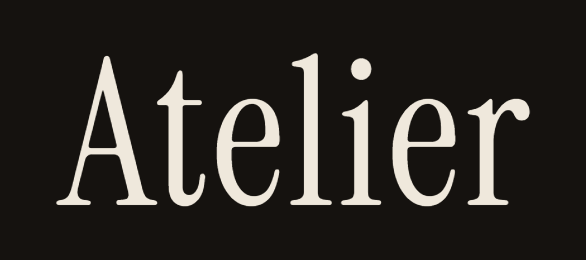
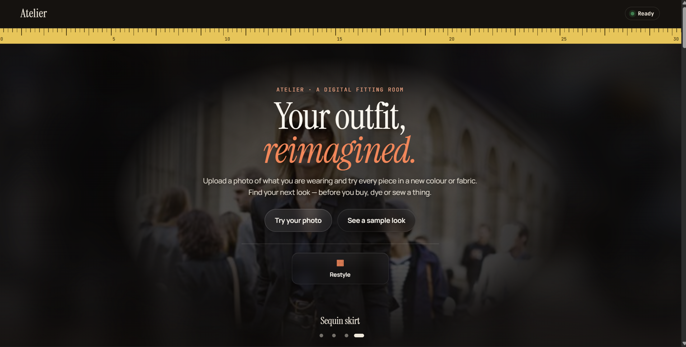
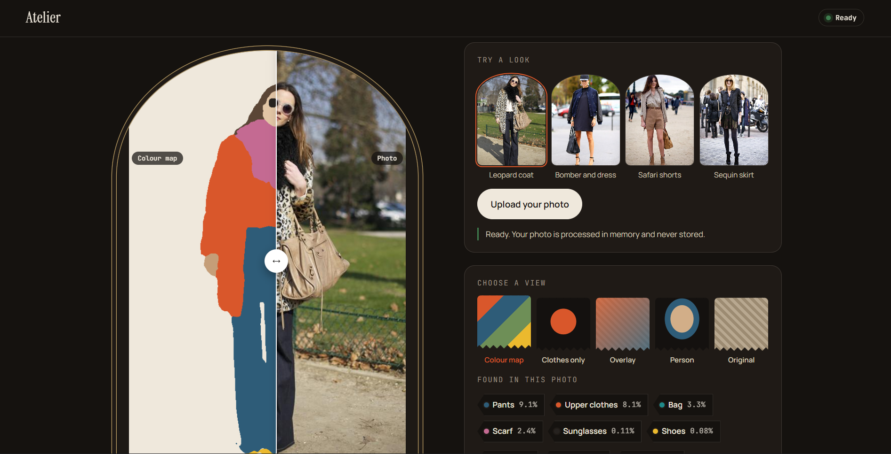
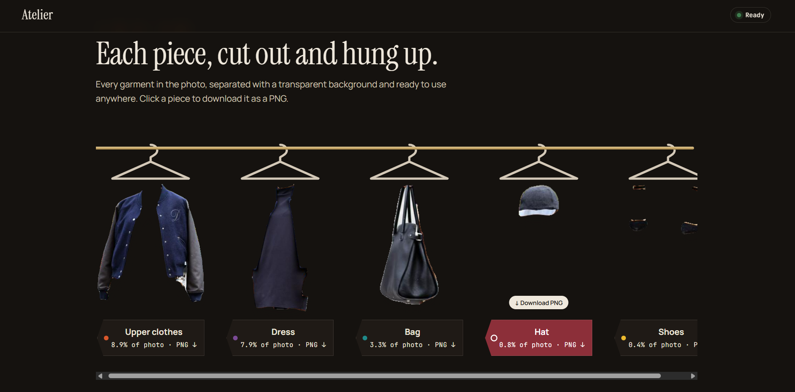
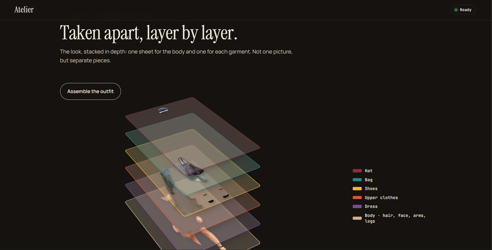
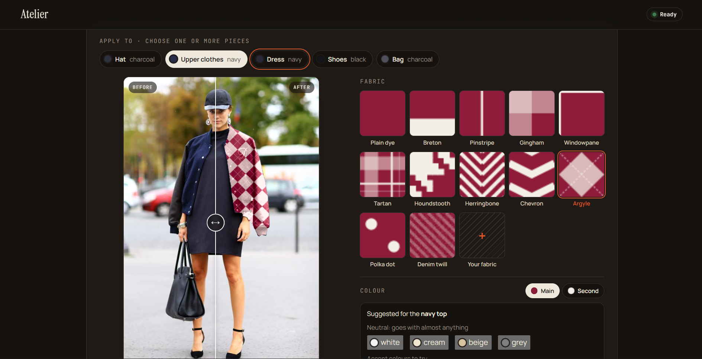

<p align="center"></p>

# Atelier — clothes segmentation and outfit restyling

Segments the clothes worn by a person in a photo. Given a personal photo of any size, the pipeline returns a label mask, a colour overlay, and one transparent cut-out per garment. **Atelier**, the web app in [`demo/`](demo/README.md), is built on it: upload a photo of what you are wearing and try every piece in a new colour or fabric.

<p align="center"></p>

- **Model:** SegFormer-B3, fine-tuned from ImageNet weights.
- **Dataset:** ATR (17,706 single-person fashion photos), mapped to 15 classes.
- **Task code:** CVCY002, Computer Vision Engineer assessment.

The reasoning behind every choice (dataset, model, loss, settings), with sources, is in the report, [report_latex/report.pdf](report_latex/report.pdf) (LaTeX source: [report_latex/report.tex](report_latex/report.tex)).

## The website: Atelier

| Fitting room | The rail |
|---|---|
|  |  |
| Upload a photo or pick a sample; compare the photo with the colour map, the clothes alone, an overlay or the person without background. | Every garment found, cut out on a transparent background and downloadable as PNG. |
| **Anatomy of an outfit** | **Style studio** |
|  |  |
| The outfit taken apart into stacked 3D layers, one per garment. | Dye one or several pieces any colour or dress them in one of 12 fabrics (or your own), keeping their folds; before/after slider and download. |

The public site is a **showcase**: five sample looks, segmented by the model ahead of time, with every view, cut-out and restyle computed in the browser — no server needed, so it is hosted for free as a static site. Run the model server locally to upload your own photos. Setup and deployment: [demo/README.md](demo/README.md).

## Results

Held-out test split (960 images), final model: SegFormer-B3 trained for 30 epochs, predictions at the original image size, with flip averaging. The test split was evaluated once, after every setting was fixed.

| Metric | Test | Validation |
|---|---|---|
| mIoU, 15 classes | 0.789 | 0.789 |
| Garment-only mIoU, 10 classes | 0.744 | 0.744 |
| Clothing against everything else (binary IoU) | 0.930 | 0.930 |
| Pixel accuracy | 0.970 | 0.972 |
| Boundary mIoU | 0.731 | 0.735 |

Prediction time for one photo, whole pipeline on an NVIDIA L4: 56 ms, or 105 ms with flip averaging. Per-class results, the confusion matrix and failure cases are in the report, [report_latex/report.pdf](report_latex/report.pdf).

## Classes

| Id | Class | Id | Class | Id | Class |
|---|---|---|---|---|---|
| 0 | background | 5 | skirt | 10 | face |
| 1 | hat | 6 | pants | 11 | legs |
| 2 | hair | 7 | dress | 12 | arms |
| 3 | sunglasses | 8 | belt | 13 | bag |
| 4 | upper-clothes | 9 | shoes | 14 | scarf |

Garment classes are 1, 3 to 9, 13 and 14. ATR's left and right shoes, legs and arms are merged. ATR has no coat class, so jackets and coats are labelled upper-clothes.

## Repository layout

```
├── README.md
├── report_latex/          # the report: report.tex (LaTeX source) and report.pdf
├── requirements.txt       # training on Colab (unpinned on purpose)
├── requirements-inference.txt  # pinned versions for running the model locally on CPU
├── assets/                # figures and tables used by the report
├── reports/               # evaluation outputs behind the report's numbers (metrics.json, per_class.csv, confusion matrices)
├── docs/images/           # screenshots of the website
├── demo/                  # Atelier: website (demo/web) and its model server (demo/server); see demo/README.md
├── .github/workflows/     # checks run on every push (website build, Python compile)
├── notebooks/
│   ├── executed/                           # the notebooks as they ran on Colab, with their outputs (evidence)
│   ├── colab_runner.ipynb                  # data preparation, sanity check, GPU benchmark
│   ├── colab_train.ipynb                   # model comparison (bake-off)
│   ├── colab_eval.ipynb                    # evaluation, own photos, final training
│   ├── colab_my_photos.ipynb               # upload photos, see colour map, clothes-only, cut-outs
│   ├── colab_ccp_compare.ipynb             # test on a new dataset (CCP): before training, public model, ours
│   ├── colab_model_compare.ipynb           # YOLO26x-sem trained 12 epochs on ATR vs ours, SCHP-ATR, FASHN
│   ├── colab_why_ours_wins.ipynb           # why every other model is below ours: errors and worst photos
│   ├── colab_ranks.ipynb                   # fine-tuning, learning-rate and ensemble tests
│   ├── colab_dual.ipynb                    # merged two-encoder model and ensemble test
│   └── colab_ablation_augmentation.ipynb   # training without augmentation
├── scripts/
│   ├── prepare_data.py    # download ATR, resize, split, cache
│   ├── sanity_check.py    # dataset audit and overlay figure
│   ├── benchmark.py       # speed and memory of the candidate models
│   ├── train.py           # train or resume a run
│   ├── resume_test.py     # proves that stop-and-resume works
│   ├── finetune.py        # continue from a checkpoint: weight averaging, or another input size
│   ├── compare_runs.py    # table and curves of several runs
│   ├── evaluate.py        # metrics, confusion matrix, best and worst examples
│   ├── train_yolo_sem.py  # train YOLO26x-sem on ATR (Ultralytics, installed by its notebook)
│   └── segment.py         # segment a photo or a folder of photos
├── tools/
│   ├── build_eval_notebook.py  # builds the notebooks and clothseg_code.zip
│   ├── build_space.py          # assembles the Hugging Face Space for the model server
│   └── make_report_charts.py   # draws the report's charts into assets/charts/
└── src/clothseg/
    ├── labels.py          # class names, ATR-to-15 mapping, palette
    ├── config.py          # settings that define a run
    ├── models.py          # model factory
    ├── dual.py            # two-encoder network: SegFormer + ConvNeXt encoders, fusion decoder
    ├── external.py        # YOLO26x-sem, SCHP-ATR and FASHN behind the same predict() for comparisons
    ├── diagnose.py        # where a model's errors are: confusions, outlines, size, missed garments
    ├── losses.py          # cross-entropy + Lovász-Softmax
    ├── metrics.py         # confusion matrix, IoU, Dice
    ├── checkpoint.py      # atomic saves, rotation, resume
    ├── engine.py          # training and validation loops
    ├── inference.py       # Python API
    └── data/              # download, preprocess, splits, dataset, transforms, storage
```

## Setup

### Google Colab (the tested path)

Open a notebook from `notebooks/` in Colab and choose a GPU runtime. Training needs an L4 (22 GB); evaluation and inference also run on a T4. Each notebook mounts Google Drive, fetches the code, installs the requirements and prepares the data. Set `REPO_URL` in the first cell to this repository's URL.

Tested with Python 3.13, PyTorch 2.11.0, transformers 5.18.0, segmentation-models-pytorch 0.5.0, timm 1.0.30.

### Any machine with a GPU

```bash
git clone <this repository>
cd <repository folder>
pip install -r requirements.txt
```

`requirements.txt` does not pin PyTorch, so an existing GPU build is kept. In the commands below, `--drive-root` is a folder that persists (runs, logs and the dataset archive are stored there) and `--local-root` is a fast local folder for the extracted dataset. On Colab they are `/content/drive/MyDrive/clothseg` and the default `/content/data`.

## Data

```bash
python scripts/prepare_data.py --drive-root <persistent folder> --local-root <fast folder>
python scripts/sanity_check.py --local-root <fast folder> --out-dir <persistent folder>/reports
```

`prepare_data.py` is safe to run at the start of every session and skips whatever is already done:

1. Downloads ATR from the Hugging Face Hub ([mattmdjaga/human_parsing_dataset](https://huggingface.co/datasets/mattmdjaga/human_parsing_dataset), about 800 MB) and keeps a copy in the persistent folder.
2. Resizes every photo to fit inside 576×384 keeping its aspect ratio, and stores the masks with the original 18 ATR ids.
3. Drops byte-identical duplicate photos, then splits with seed 42.
4. Moves near-duplicate photos that sit in more than one split into the training split, so validation and test contain no copy of a training photo.
5. Packs the result into one archive in the persistent folder. Later sessions only copy and extract it.

Resulting split sizes: 16,038 train and 690 validation images; the test split has the remaining images of its original 1,000.

`sanity_check.py` prints image sizes, class frequencies and remaining cross-split near-duplicates, and saves a figure of random samples with their masks.

## Training and resuming

```bash
python scripts/train.py --drive-root <persistent folder> --local-root <fast folder> \
    --run-name final_segformer_b3_e30 --model segformer_b3 --epochs 30
```

The same command starts a run and resumes it. Everything about a run lives in `<persistent folder>/runs/<run-name>/`: `config.json`, `train_log.csv`, `val_log.csv` and `checkpoints/`.

- A checkpoint is written every 10 minutes, after every epoch, and when `--time-budget-min` is reached. It holds the model, optimiser and GradScaler states, the position inside the epoch, the best metric, the random-generator states and the config.
- Checkpoints are written to a temporary file and renamed, so an interrupted save cannot leave a broken file. The last two are kept, plus `best.pt` (best validation mIoU).
- The order of each epoch and every augmentation depend only on (seed, epoch, position), so a run resumed in the middle of an epoch continues with the batches it would have seen. GPU arithmetic is not bit-reproducible, so a resumed run matches an uninterrupted one closely, not bit for bit.
- Reusing a run name with different settings is refused with a message that lists the differences.
- `--extend-from <finished run>` with a larger `--epochs` continues a finished run under a new run name, with the longer schedule: weights, optimiser state, step counter and data order carry over, and the learning rate steps back up to where the longer schedule would be. The finished run is only read. This was used to continue the merged two-encoder model from 12 epochs on a 30-epoch schedule; that run was stopped after epoch 17 (report, section IV-D).

Check the resume logic before a long run:

```bash
python scripts/resume_test.py --drive-root <persistent folder> --local-root <fast folder>
```

Default settings (all can be changed on the command line; see `python scripts/train.py --help`):

| Setting | Value |
|---|---|
| Input size | 576×384 (height × width) |
| Batch size | 16 |
| Optimiser | AdamW, weight decay 0.01 |
| Learning rate | 6e-5 encoder, 6e-4 head |
| Schedule | 1,500 warm-up steps, then linear decay to zero |
| Loss | 0.5 × cross-entropy + 0.5 × Lovász-Softmax |
| Precision | fp16 mixed precision |
| Seed | 42 |

Models available through `--model`: `segformer_b2`, `segformer_b3`, `segformer_b4`, `upernet_convnext_tiny`, `deeplabv3plus_resnet101`, `segformer_b3_edge`, `segformer_b3_ade`, `dual_b3_convnext_tiny`.

**GPU memory.** SegFormer-B3 at batch size 16 needs about 14.4 GB for training and was trained on an L4. It does not fit a 16 GB T4 reliably. SegFormer-B2 (11.8 GB) does.

## Evaluation

```bash
python scripts/evaluate.py --checkpoint <persistent folder>/runs/<run-name>/checkpoints/best.pt \
    --split val --local-root <fast folder> --out-dir <persistent folder>/reports/eval_val
```

Writes `metrics.json`, `per_class.csv` (IoU, Dice, accuracy and Boundary IoU per class), `confusion_matrix.csv`, `confusion_matrix.png`, `best_examples.png` and `worst_examples.png`. Predictions are compared with the masks at the original image size.

- `--split test` evaluates the held-out test split. It should be used once, for the final model.
- `--flip-tta` averages each prediction with the prediction on the mirrored photo.

## Trained model

The final model is too large for the repository (189 MB). It is attached to this repository's **Releases** page as `best.pt`.

| | |
|---|---|
| Run | `final_segformer_b3_e30`, best epoch 28 of 30 |
| Validation (576×384, during training) | mIoU 0.7866, garment mIoU 0.7426 |
| SHA-256 | `7e460595af2b7e0471414652dcf1a956ecd099e70be3abea2901ff345f4a82b2` |

It was saved with `transformers` 5.18, which names SegFormer's weights differently from earlier releases. The loader translates between the two naming schemes, so the file also loads with older versions; tested with 5.5 on a local GPU and 5.18 on Colab.

## Inference

```bash
python scripts/segment.py --checkpoint best.pt --input photo.jpg --out-dir out
python scripts/segment.py --checkpoint best.pt --input my_photos/ --out-dir out
```

For each photo it writes:

| File | Content |
|---|---|
| `<name>_mask.png` | Label mask at the photo's own size; pixel value = class id |
| `<name>_overlay.jpg` | The photo with class colours blended on top |
| `<name>_<garment>.png` | One transparent cut-out per garment found |
| `<name>.json` | The classes found and the share of the photo each covers |

It accepts JPEG, PNG, WebP, BMP and TIFF, applies EXIF rotation, and handles any size and aspect ratio. A file that cannot be read is reported and skipped.

Python API:

```python
from clothseg.inference import Segmenter, load_image, save_outputs

seg = Segmenter("best.pt")              # flip_tta=True for mirrored averaging
image = load_image("photo.jpg")         # RGB array, EXIF rotation applied
mask = seg.predict(image)               # class ids, same height and width as the photo
overlay = seg.overlay(image, mask)
cutouts = seg.cutouts(image, mask)      # {"upper-clothes": RGBA image, ...}
save_outputs(image, mask, seg, "out", "photo")
```

Add `src/` to `PYTHONPATH` to import `clothseg` from outside the `scripts/` folder.

## Demo website

`demo/` holds **Atelier**, a web app built on the model: upload a photo of an outfit, see every garment separated and cut out, and try any piece in a new colour or fabric (12 fabrics, suggested colours, finish, before/after slider) — all in the browser. It also holds the small API server the site calls, which wraps the same `Segmenter`. Setup and deployment are in [demo/README.md](demo/README.md).

## Reproducing the results

All runs use seed 42, batch size 16, input 576×384 and the default settings above. Run `prepare_data.py` first.

```bash
R="--drive-root <persistent folder> --local-root <fast folder>"

# Model comparison, round 1: five models, first 5 epochs of a 12-epoch schedule
for m in segformer_b2 segformer_b3 segformer_b4 upernet_convnext_tiny deeplabv3plus_resnet101; do
  python scripts/train.py $R --run-name r1_$m --model $m --epochs 12 --stop-after-epoch 5
done
python scripts/compare_runs.py --drive-root <persistent folder> --prefix r1_ --at-epoch 5

# Round 2: the three best continue to epoch 12 (the same commands without --stop-after-epoch)
for m in upernet_convnext_tiny segformer_b3 segformer_b4; do
  python scripts/train.py $R --run-name r1_$m --model $m --epochs 12
done

# Architecture experiment: SegFormer-B3 with an edge branch
python scripts/train.py $R --run-name abl_segformer_b3_edge --model segformer_b3_edge --epochs 12

# Augmentation ablation: SegFormer-B2 without augmentation
python scripts/train.py $R --run-name abl_segformer_b2_noaug --model segformer_b2 --epochs 12 --stop-after-epoch 5 --no-augment

# Final model
python scripts/train.py $R --run-name final_segformer_b3_e30 --model segformer_b3 --epochs 30
```

## Executed notebooks (evidence)

`notebooks/executed/` holds the notebooks exactly as they ran on Google Colab, with every printed output, table and figure. All cells that ran finished without errors.

| Notebook | What it ran | Report |
|---|---|---|
| `colab_runner_executed.ipynb` | Data download, audit, splits, sanity check, GPU benchmark | Section I |
| `colab_train_executed.ipynb` | Model comparison, rounds 1 and 2 | Section II |
| `colab_eval_executed.ipynb` | Final training and evaluation on validation and test | Section IV-B |
| `colab_ccp_compare_executed.ipynb` | Test on a dataset never seen (CCP): before training, a public model, ours | Section IV-B |
| `colab_why_ours_wins_executed.ipynb` | Error analysis against YOLO26x-sem, SCHP-ATR and FASHN | Section IV-C |
| `colab_ranks_executed.ipynb` | Two fine-tuning experiments on the final model | Section IV-D |
| `colab_improve_executed.ipynb` | Two improvement experiments | Section IV-D |
| `colab_dual_executed.ipynb` | Merged two-encoder model | Section IV-D |

## Limitations

A short list; details and examples are in the report, [report_latex/report.pdf](report_latex/report.pdf).

- Trained on single-person, full-body fashion photos. Crowded scenes, unusual poses and heavily cropped bodies are outside the training data.
- A jacket or coat cannot be separated from the top under it (no coat class in ATR).
- The model confuses garment types in ambiguous cases: a dress against a top with a skirt, or a long coat against a dress.
- Small, thin items are the weakest classes: belt, scarf and sunglasses.
- Clear glasses are not detected; the class is sunglasses.

## Licences

- Code in this repository: written for this assessment.
- SegFormer pretrained weights (`nvidia/mit-b*`): [NVIDIA Source Code License](https://github.com/NVlabs/SegFormer/blob/master/LICENSE), for research and evaluation use only. Section 3.3 applies to derivative works, so the fine-tuned model (`best.pt`) and the Atelier demo are for **non-commercial research and evaluation use only**.
- ATR dataset: no licence is stated by its authors or on the Hugging Face copy.
- Sample photos in the website: Clothing Co-Parsing dataset (Apache-2.0).
